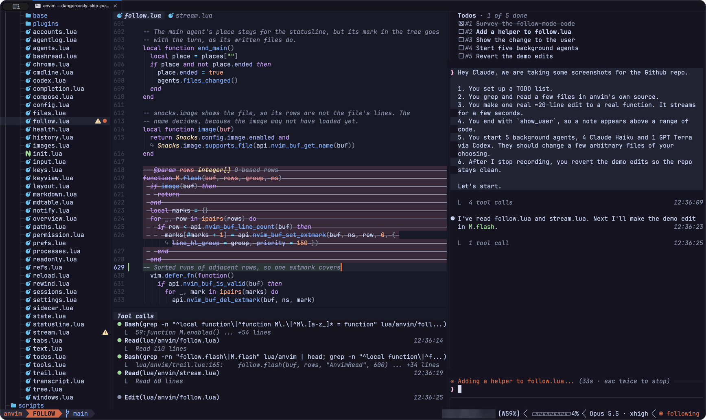
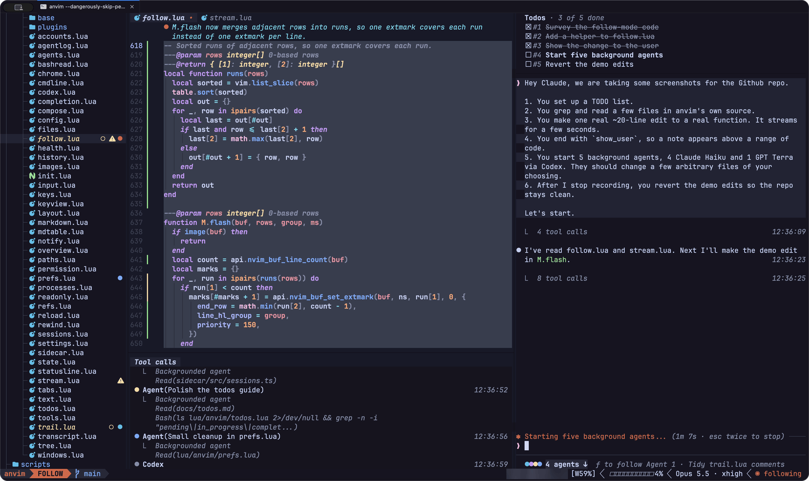
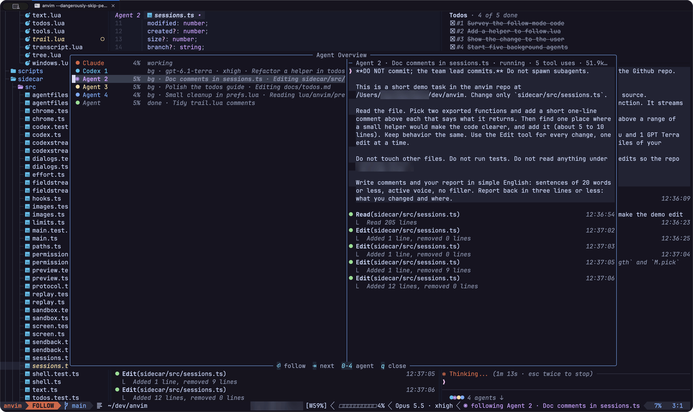

# *anvim*

*anvim* is an agentic Neovim workspace for Claude Code.

A Claude Code harness built around the code.

Follow Claude through your project, watch edits take shape, and use familiar Vim motions, search, LSP and Git tools to explore the code.







See more screenshots [here](docs/screenshots/).

## See the work. Stay in it.

Claude Code's terminal tells you `Read(src/app.ts)`, then `Update(src/app.ts)`. *anvim* opens the file so you can see what Claude is actually up to.

- Follow Claude from file to file, right down to the lines it's reading.
- Watch edits stream in, with old text struck through, before the changes reach disk.
- Keep tabs on agents by their colored dots in the explorer. While agents are running, press `Ctrl-F` in normal mode to cycle through them and back to Claude; the code window and tool pane follow the selected agent.
- Peek at the Agent Overview for each agent's task, context use and tool calls.
- Bring [Codex](docs/subagents.md#codex-agents) along with `--codex`: ask Claude to hand it a task, and it gets its own dot and row like everyone else.

Hop out of the prompt to review code with LSP, grep, git log and diffs. `<leader>j` brings you back to Claude when you've found something to point at.

Code buffers are for navigation and review; Claude makes the edits. If you want to edit a file yourself, open your usual Neovim. *anvim* picks up the changes from disk.

## Claude Code under the hood

The Agent SDK runs the real Claude Code engine, so your login, sessions and `CLAUDE.md` files come along for the ride.

Your skills, plugins, MCP servers, hooks, settings, permission rules, subagents and sandbox work as they do in Claude Code.

The SDK leaves the interface to us. Here's what *anvim* puts back:

- A conversation that stays easy to read: tool calls and results go in a separate pane beneath the code, while the transcript summarizes each run. Hide the pane with `<leader>us` to show calls in the transcript instead.
- A todo list per project, which `/clear` keeps and `/reset` deletes.
- The prompt: `@` and `/` completion, past prompts and pasted images.
- `Ctrl-G` for long prompts, `Up` to retrieve queued prompts, `Ctrl-B` to background agents.
- Permission requests, Claude's questions and plan approval.
- The statusline: permission mode, model, effort and context use.
- `/resume`, `/model` and `/effort`; Settings for `/status`, `/usage`, `/context`, `/mcp` and `/chrome`.

Claude Code sends subagent edits in one go; *anvim* types them into the buffer as you watch. It also spots files in Bash commands such as `cat` and `grep -n`.

You'll still need Claude Code's terminal for MCP sign-in, paid cloud reviews and terminal-only commands such as `/doctor`.

## Quality of life

- Timestamps on every prompt, reply, tool call and notice, including agent logs and resumed sessions.
- safe-Esc, because Vim users tend to spam `Esc` just to be sure. Stopping Claude or answering no takes two presses with a pause, so a quick burst won't accidentally cancel anything.
- If Claude asks for permission while you're typing a prompt, you can finish your thought without accidentally approving or rejecting anything. Press `Esc` to leave insert mode, then choose an answer.
- Moving focus won't start insert mode. Use `i`, `a`, `c` or another insert command when you're ready to type.
- Claude doesn't automatically receive the file or selection you're viewing. Add a reference when you want to point something out.
- Keys follow LazyVim, so they should feel familiar. Keys that change files sit this one out.
- The transcript and tool pane stay out of your cursor's way. Scroll with the mouse wheel; drag to copy text.
- Notifications only pipe up when *anvim* is out of sight.
- Switch Claude accounts with `/account`, or add one with `/account add <name>`. anvim remembers your choice per project; see [accounts](docs/sessions.md#accounts).

## Install

You'll need Neovim 0.12 or newer, git, [Bun](https://bun.sh) and Claude Code, logged in. Codex is optional: bring the Codex CLI, logged in, and start with `--codex`. The [install guide](docs/install.md) has the full list.

```sh
git clone https://github.com/DavidBachmann/anvim.git
cd anvim
scripts/install
mkdir -p ~/.local/bin
ln -s "$PWD/bin/anvim" ~/.local/bin/anvim
```

*anvim* keeps its plugins, state and config separate from your usual Neovim setup. It reads nothing from `~/.config/nvim`, so your config can stay exactly as you like it.

## Start

```sh
anvim ~/dev/project
```

You'll get three columns: the explorer, the code and Claude. Your cursor starts in the prompt, in normal mode. Press `i`, type something, then press `Enter`.

The code window follows Claude while your cursor stays in the prompt. Wander off to review whenever you like; `<leader>j` brings you back.

Select lines and press `c` to put a reference such as `@src/app.lua#L12-30` in the prompt. Claude Code reads those lines with your prompt. Think of `c` as "change this, Claude".

By default, Claude starts in bypass mode with the Bash sandbox on. It can edit files and run sandboxed commands without ordinary permission prompts. The sandbox permits writes in the project and some other locations; see [permissions and the sandbox](docs/permissions.md) for details. `anvim --mode default` asks before operations that need approval.

```sh
anvim --model haiku ~/dev/project      # pick a model
anvim --mode default ~/dev/project     # ask before edits and commands
anvim --account personal ~/dev/project # use the login in ~/.claude-personal
anvim -c ~/dev/project                 # pick up the latest session
anvim --resume ~/dev/project           # pick a session
anvim --debug ~/dev/anvim              # let Claude work on anvim itself
```

`<leader>` is Space. If you forget a key, `<leader>?` has the whole list.

## Docs

- [Install, update and uninstall](docs/install.md)
- [The screen](docs/screen.md): the columns, follow mode, the tool pane, the tab bar
- [The prompt](docs/prompt.md): references, the compose window, images, past prompts
- [Keys](docs/keys.md)
- [Sessions and slash commands](docs/sessions.md)
- [The transcript](docs/transcript.md)
- [Subagents](docs/subagents.md)
- [Permissions and the sandbox](docs/permissions.md)
- [Development](docs/development.md): the gates, record and replay, the screen tool

## Make it yours

*anvim* is one person's workflow, with no releases or compatibility promise. Most of it was written inside *anvim*. With `anvim --debug`, Claude can work on the very thing it's sitting in: read the screen, make changes and restart *anvim* to try them out.

Fork it, fix the bit that annoys you, and point `anvim --debug` at your fork. Issues and pull requests are welcome. So is a fork that quietly makes your day better.

## License

[MIT](LICENSE)
