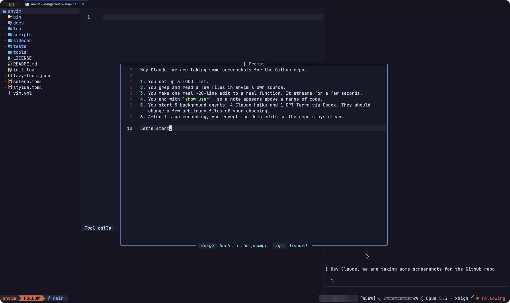
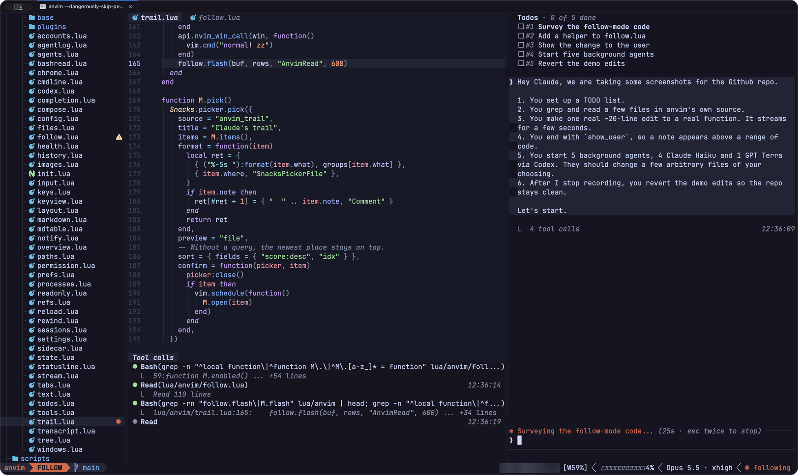
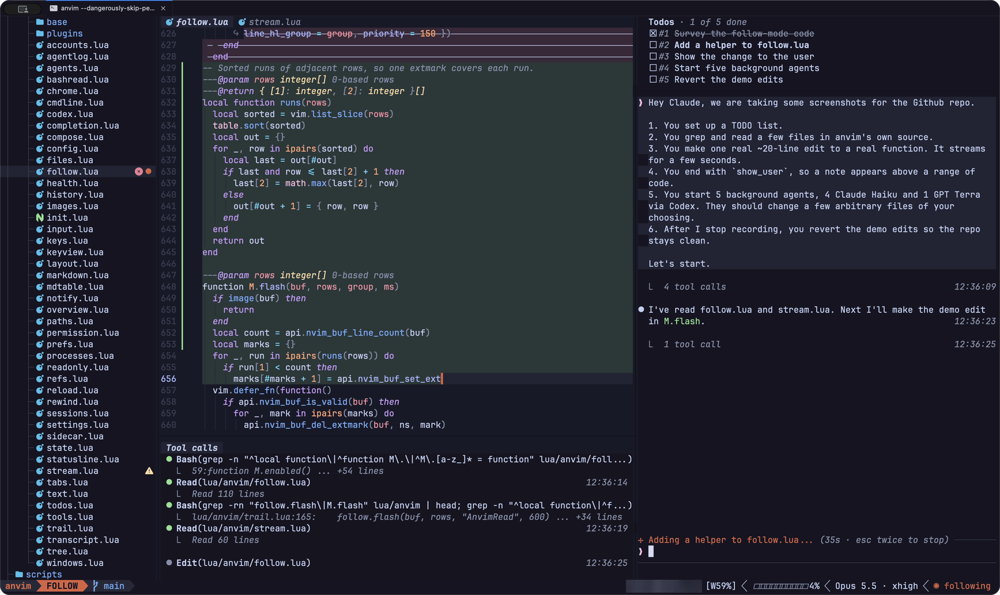
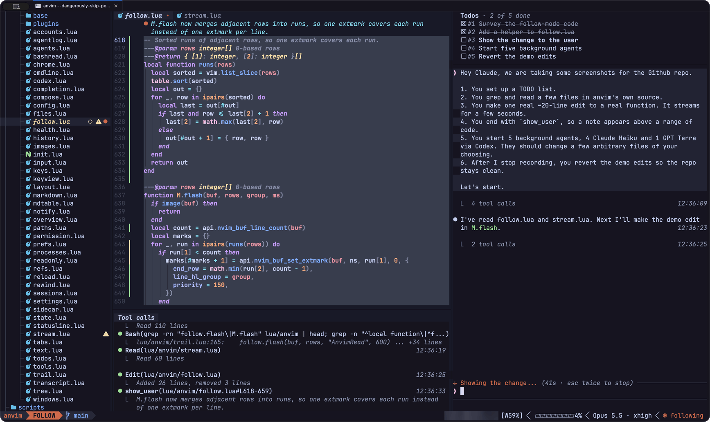
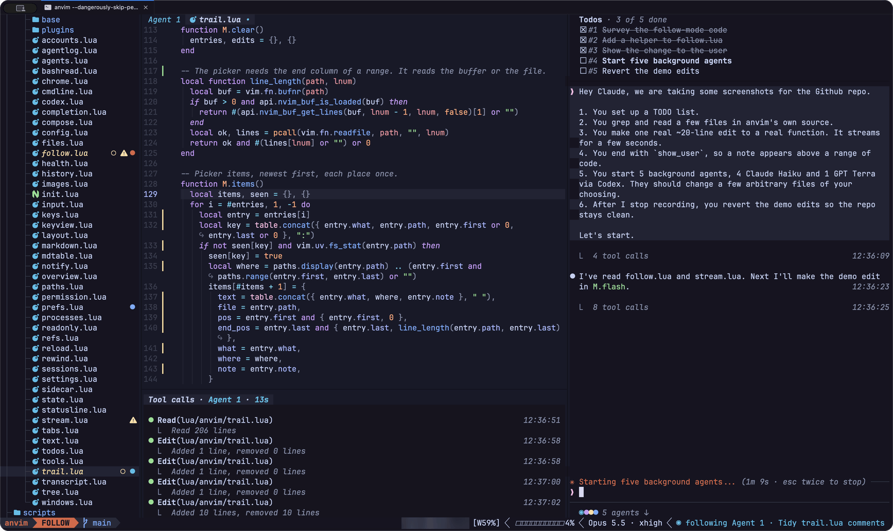
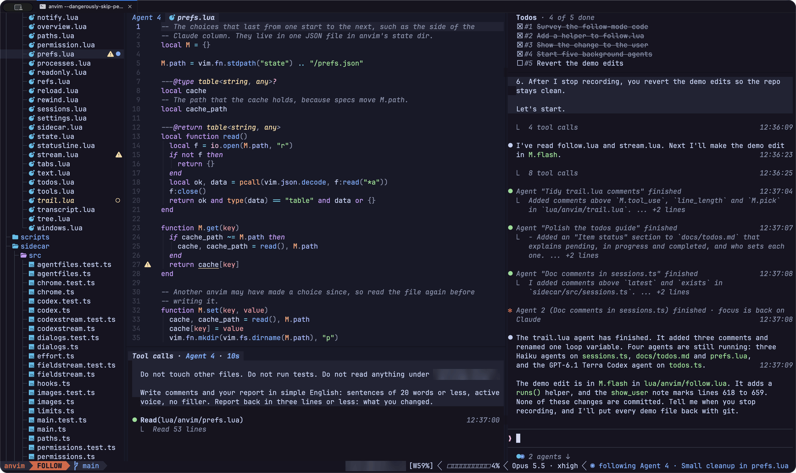
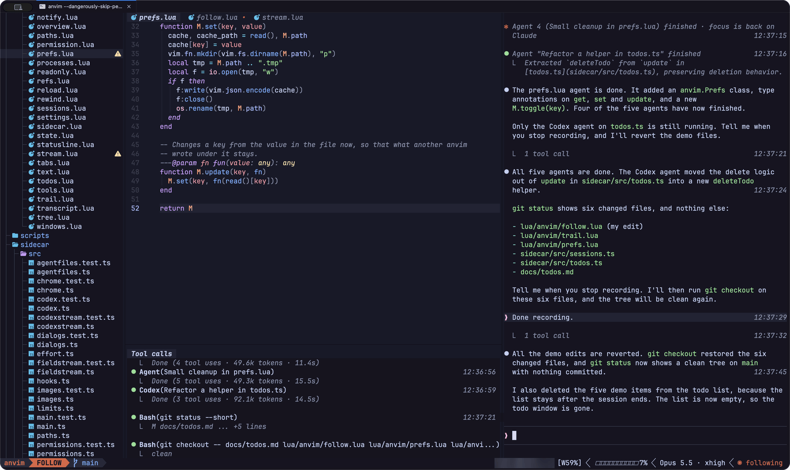
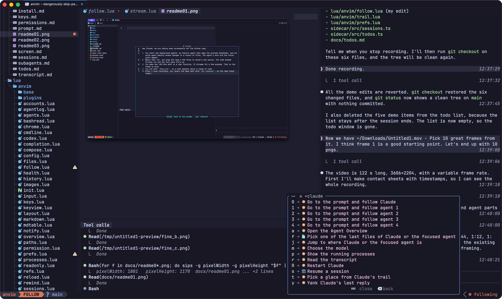
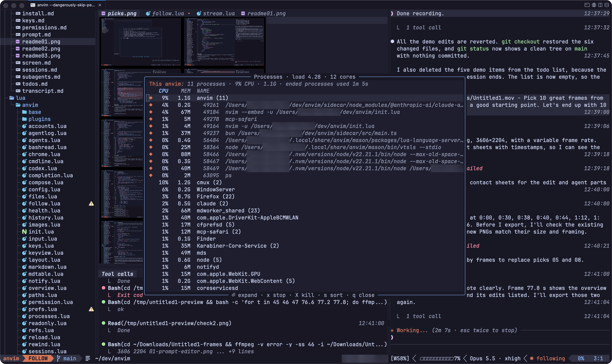

# Screenshots

These shots come from one short session. Claude reads anvim's own source, edits a function and points at the change. Then it starts five background agents: four Claude Haiku agents and one GPT-6.1 Terra agent through Codex. At the end, Claude reverts every edit.

## Following Claude

`Ctrl-G` opens a larger editor for long prompts.

Claude greps and reads the source. The code window follows each read and grep hit, the todo list sits on top, and the tool pane lists the calls.

Claude rewrites `M.flash`. The old lines are struck through while the new ones stream in.

The new code fills in. Claude Code writes the file to disk once the preview has caught up.

Claude ends with `show_user`, so a note appears above the new code.

## Background agents

Five agents start. The tool pane lists them, and the footer shows a dot in each agent's color.

anvim follows Agent 1. The code window and the tool pane show its edits to `trail.lua`.

The Agent Overview (`<leader>ca`) lists each agent with its model, task and context use. The right side shows the selected agent's prompt and tool calls.

Agent 4 adds type annotations to `prefs.lua` while you follow it.

Claude reverts the demo edits with `git checkout` and empties the todo list.

## Menus and windows

The `<leader>c` menu holds the Claude keys: follow an agent, open the Agent Overview, choose the model and more.

The Processes window (`<leader>cp`) lists anvim's own processes first, then the busiest processes on the machine.
